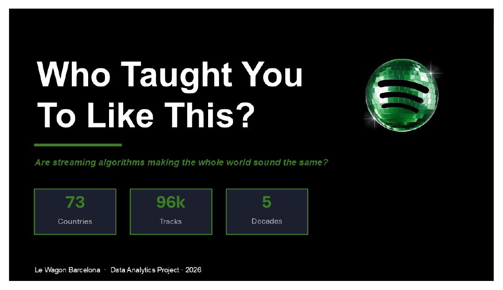
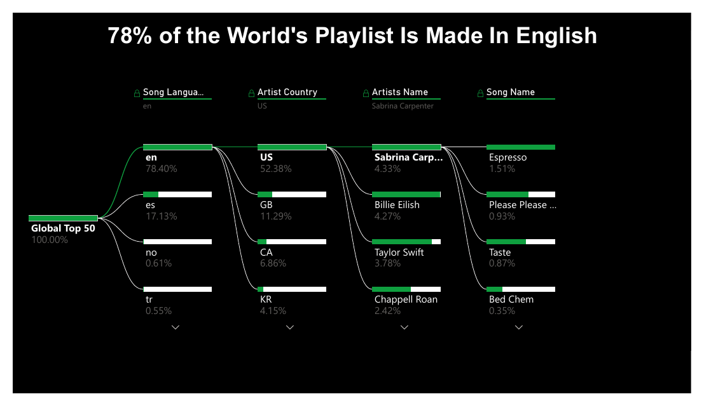
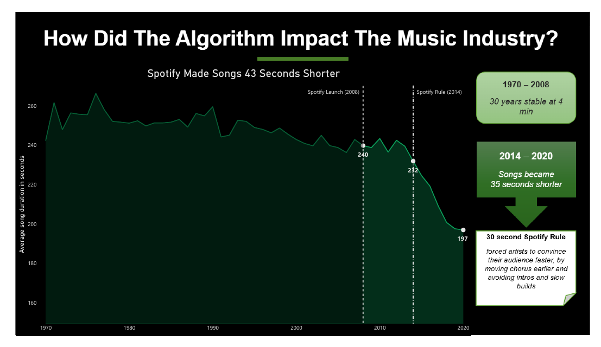
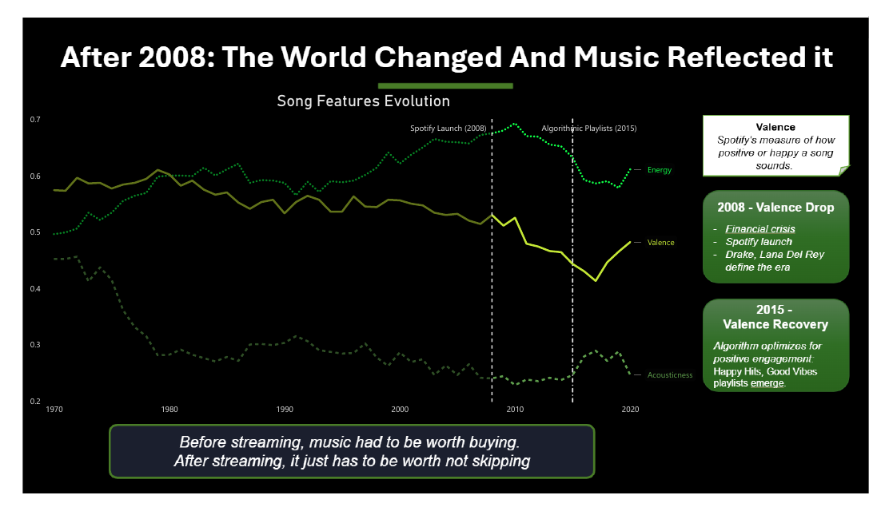
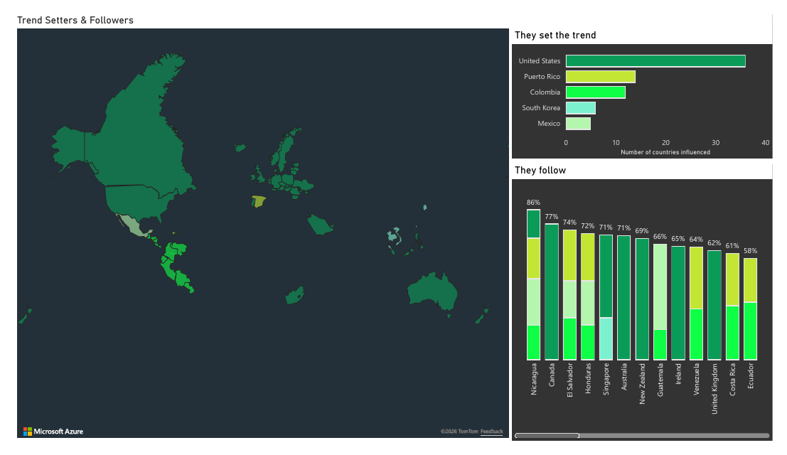
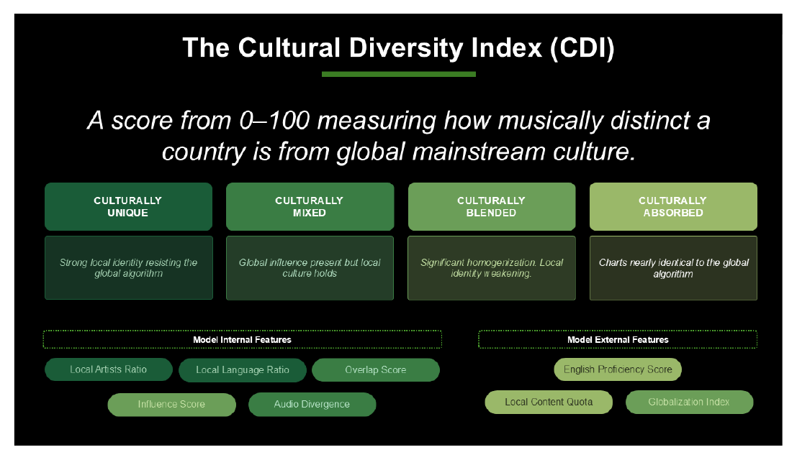
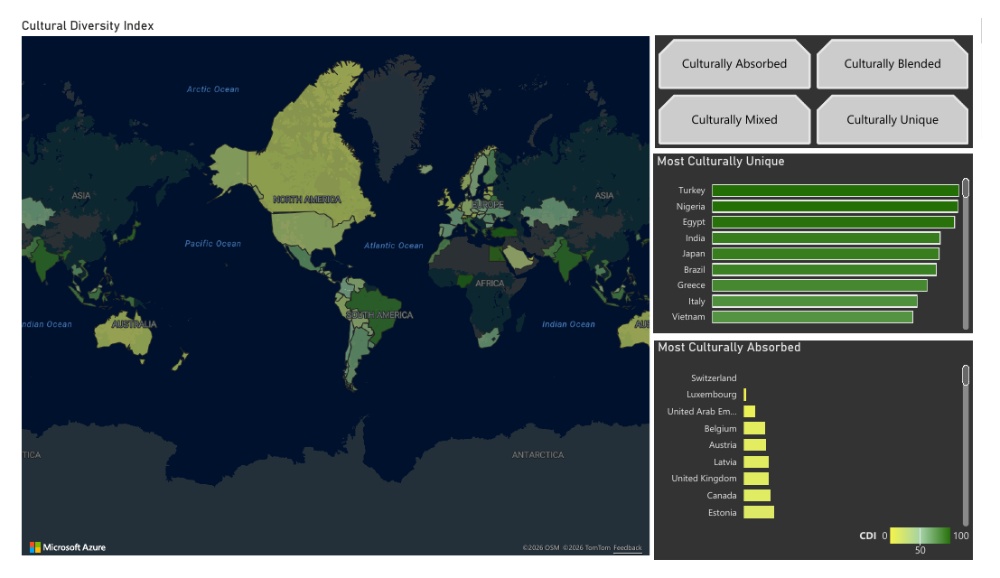
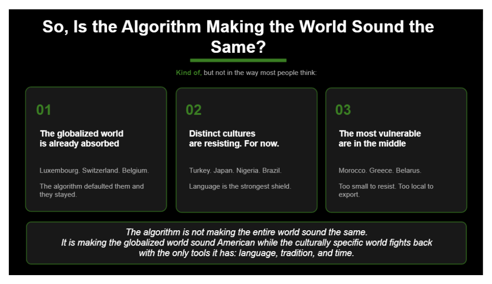

# Who Taught You To Like This?

*You probably know "Blinding Lights" by The Weeknd. It is the most streamed song in Spotify's history, with more than 5.4 billion plays. But think about it for a second: how did you find it? Did you choose it, or did it choose you?*

Somewhere in Lisbon, Seoul and Bogotá, someone is pressing play on the same song right now. Same app, same algorithm, same recommendations. So we started wondering: if the whole world listens through the same door, are we slowly learning to like the same things? And what happens to the music that makes a place feel like home?

**96,000 tracks · 73 countries · 5 decades**

[See the full presentation (PDF)](https://1drv.ms/b/c/bc4c7b1366a37864/IQDfhmVVXXjDQbtteuRPMqsnAYjNlgpb7wJwZCqEFdW9tKI?e=f3z962) · [Download the Power BI dashboard (.pbix)](https://1drv.ms/u/c/bc4c7b1366a37864/IQDuDastssLfQJPNXWe-BxqaAWhqLzkNcmf3HUOdgleOudw?e=bjq63r)

## Why it matters
Spotify has more than 760 million users, and 31% of the songs people like were discovered through an algorithm. Not a friend, not the radio, not a record shop.

It matters for brands too. A fashion brand launching in Brazil, a drinks company speaking to Korean youth, a travel brand celebrating Nigerian music: they all invest in "local" and "authentic" culture, usually based on gut feeling and stereotypes. But does that local culture still exist, or has the algorithm already absorbed it?

We set out to answer three questions:

1. Is the algorithm making music sound more uniform?
2. Which countries are still listening to their own music?
3. What does this mean for brands trying to connect with local audiences?

## What the data told us

### The world sings in English
Five English-speaking countries (the US, the UK, Canada, Ireland and Australia) make up about 78% of the global Top 50. More than half of today's hits come from just one of them: the United States. This dominance existed before Spotify. The algorithm didn't create it. It inherited it, and amplified it.

### 30 seconds to catch you
For almost 30 years, a song took about 4 minutes to tell its story. Then, in 2014, Spotify's 30-second rule arrived: a play only counts, and an artist only gets paid, if you listen for at least 30 seconds. Suddenly an artist had 30 seconds to convince the algorithm they exist. Intros and slow builds disappeared, choruses moved earlier, and songs became 43 seconds shorter.

Songs had been short once before, in the 1960s, when vinyl singles and radio DJs refused to play anything over 3 minutes. This time, nobody decided it. A machine did.

### The algorithm started editing our emotions
Valence, Spotify's measure of how happy a song sounds, stayed steady for decades. In 2008 it suddenly dropped. Spotify launched that year, but so did the financial crisis, and the melancholic sound of artists like Drake, The Weeknd and Lana Del Rey. Music was simply reflecting how the world felt.

Then, after Discover Weekly launched in 2015, happiness slowly came back. Not because people got happier, but because playlists like Happy Hits and Good Vibes reward songs that get skipped less. The algorithm didn't just reflect human emotion. It started editing it.

### Music became background
Energy tells a quieter story. As it kept falling, the algorithm accidentally created a whole new kind of music: lo-fi, ambient and bedroom pop, songs to study, work and fall asleep to.

> Before streaming, music had to be worth buying. Nobody paid to ignore it. With streaming, it just has to be worth not skipping.

Music became infrastructure: something that runs in the background while we do something else.

### Who sets the trend, and who follows
The United States, Puerto Rico, Colombia, South Korea and Mexico lead global music, each making up more than 15% of the Top 50 in four or more countries.

- **The US** shapes English-speaking and highly globalised countries. In Canada, 77% of the Top 50 is American.
- **Puerto Rico**, the birthplace of reggaeton and home of Bad Bunny, is the number 2 trendsetter in the world. Colombia and Mexico follow, carried by a language spoken across continents.
- **South Korea** is the exception. It conquered charts across Asia, Europe and the Americas without a widely spoken language, through a deliberate national strategy to turn K-pop into a global phenomenon.

Meanwhile India, Brazil and Nigeria, some of the biggest music markets in the world, have huge local industries and almost no influence on what the rest of the world hears.

### Measuring a country's musical soul
To find out who stayed truly themselves, we built our own **Cultural Diversity Index (CDI)**: a score from 0 to 100 for 72 countries. Close to 100 means a strong local musical identity. Close to 0 means a country has been absorbed into the global mainstream.

The score combines:
- **How local the charts are:** the share of local artists and songs in the local language in each country's Top 50
- **How global they are:** how much of the Top 50 also appears in the global Top 50, and how often a country's artists chart abroad
- **How different it sounds:** how far a country's average song is from the global sound (danceability, energy, valence, tempo and more)
- **The world around it:** English proficiency (EF EPI), globalisation (KOF Index) and whether the country has a law protecting local music

Turkey, Nigeria and Brazil score close to 100. They make their own music, for themselves. Switzerland, Luxembourg, Belgium and the Emirates score close to 0, almost fully absorbed.

Three things seem to protect a culture's sound:
1. **Language.** Countries that live in their own language resist. Countries fluent in English blend in.
2. **A big home market.** India, Japan and Brazil have music industries large enough to fill their own charts. Luxembourg and Switzerland can't sustain one.
3. **A sound of its own.** Samba, baile funk and forró were never built on Western pop, so they don't sound like anything else.

And a twist: the United States, the world's biggest trendsetter, scores only 24. It isn't being absorbed. It *is* the mainstream. Which leaves a question: if you share your culture with the entire world, is it still completely yours?

## So, is everyone starting to sound the same?
Kind of, but not in the way most people think.

- **The globalised world has already been absorbed.** Luxembourg, Switzerland, Belgium.
- **Distinct cultures are resisting, for now.** Turkey, Japan, Nigeria, Brazil. Language is their strongest shield.
- **The most fragile are in the middle.** Morocco, Greece, Belarus: too small to resist, too local to export.

The algorithm is not making the whole world sound the same. It is making the globalised world sound American, while the culturally specific world fights back with the only tools it has: language, tradition and time.

## What it means for brands
The CDI shows brands where local culture is still alive, and where it is fading. In culturally unique markets like Brazil or Turkey, speaking the local sound matters. In absorbed markets like Switzerland or Belgium, global culture already is the local culture. And the countries in the middle are the ones to watch, before their sound disappears.

## What we'd explore next
At the same time the algorithm flattens music, live music and vinyl are growing. People seem to be looking for what an algorithm can't give them: something real, human and local. Layering live event and vinyl sales data on top of the CDI could show how people fight back, often without even knowing it.

*And you? What did you listen to today?*

---

**Le Wagon Data Analytics Bootcamp, Barcelona 2026 · Final project**

By Beatriz Castanheira, Alyssa Ferrante and Renato Simões

**Tools:** Python · BigQuery · Power BI
